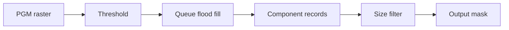

# Connected Components in Grayscale Images

C++ thresholding, flood fill and component-size filtering from UCT CSC3022, 2024.

Live interactive portfolio demo: [pixels into regions](https://azharabdool.vercel.app/playground/connected-components/). This is a separately labelled TypeScript recreation on a new synthetic raster, not the original C++ executing in the browser.

## Overview

Identify foreground regions in a binary PGM raster and retain components within a selected size range. The individual submission implements raster I/O, component storage, copy/move operations and a command-line driver.

## Technical Approach

Threshold pixels, traverse four-connected foreground neighbours with a queue and store connected coordinates. Filter the resulting components by size and write a mask. The submitted traversal is retained; input validation and narrowly scoped ownership/iterator safety fixes are labelled post-project improvements below. This is classical image processing, not a trained ML model.

## Tech Stack

C++17, standard-library containers, CMake. Optional Python 3 standard-library verification; no external runtime library.

## Key Features

- Binary PGM input/output and configurable threshold.
- Queue-based component extraction and size filtering.
- Copy/move operations and component summaries.

## Architecture / Pipeline



## Results

The public example is a new synthetic 144x96 raster processed by the actual submitted implementation. Threshold 128 and minimum size 20 retain regions of 625 and 600 pixels. A size ceiling of 610 retains only the 600-pixel region. The small nine-pixel region and below-threshold rectangle are excluded.

The original private verification passed 19 assertions across two submitted test cases. Those tests and their unverified supplied fixtures are not redistributed. The public six-check regression test is newly authored portfolio verification, not historical coursework coverage.

## Running the Project

```sh
cmake -S . -B build
cmake --build build
ctest --test-dir build --output-on-failure
# Single-config build; Windows multi-config builds may use build/Debug/components.exe.
./build/components -t 128 -s 20 1000 -p -w generated-mask.pgm examples/synthetic-input.pgm
# Optional malformed-input and mask verification (Python 3):
python input_checks.py ./build/components
```

## Project Structure

`PGMimageProcessor.*`: raster and component processing; `ConnectedComponent.*`: coordinate records; `driver.cpp`: command-line entry point; `examples/`: authored input and real generated mask; `synthetic_tests.cpp` and `input_checks.py`: new verification.

## What I Learned

Raster parsing, connected-region algorithms, container ownership, C++ copy/move semantics and correctness testing.

## Possible Improvements

Extend copy/move and connectivity edge-case tests, add sanitizer coverage and improve boundary-pixel counting, which currently performs linear coordinate searches for each neighbour. Image extraction mutates the raster, so use a fresh processor for each extraction. Only 8-bit P5 with maximum value 255 is supported.

## Portfolio Cleanup / Post-project Improvements

Added CMake and a synthetic regression fixture/test; removed trailing whitespace only from preserved source. Supplied Birds/chess images, derived fixture masks, Catch and the fixture-dependent original tests are withheld. The underlying algorithm is not replaced with a new implementation.

## Portfolio Enhancements

The cleaned CLI now rejects missing/unknown options, invalid integers and out-of-range thresholds/component sizes instead of indexing missing arguments. The P5 reader validates header tokens, dimensions, maximum value 255 and raster length, with bounded allocation and safe temporary ownership. Only 8-bit binary P5 is supported. Component traversal/filtering is retained.

Release-day review additionally rejects threshold zero (zero is the traversal's visited marker), releases each temporary component through scoped ownership and uses the iterator returned by `erase` rather than decrementing the first element. These are 2026 safety changes, not original submission features.

Six synthetic regression checks, ten original malformed-input checks and four new safety/output checks passed on 2026-10-12. The latter verify zero-threshold rejection, removal of the first/all components and every byte of the generated synthetic mask. Header comments and CRLF separators are handled; raster pixels are not consumed as generic trailing whitespace. These are finite correctness checks, not a security audit or image-accuracy benchmark.
