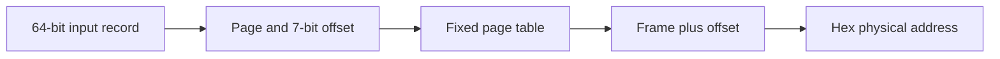

# Operating Systems: Address Translation and Scheduling Notes

An individual Java virtual-address translator and documentation of related scheduling coursework.

New browser explanations: [virtual-address explorer](https://azharabdool.vercel.app/playground/virtual-memory/) and [Andre's scheduling simulation](https://azharabdool.vercel.app/playground/andre/). These are portfolio recreations, separate from the original Java source. Andre uses synthetic inputs and corrected timing boundaries; historical invalid aggregates remain disclosed.

## Overview

UCT CSC3002, 2024. Translate little-endian eight-byte address records through a fixed page table. Scheduling experiments are documented, but their teaching scaffold is withheld pending reuse permission.

## Technical Approach

Compute page = address >> 7, offset = address & 0x7F and physical = (pageTable[page] << 7) + offset. The assignment-defined frame table is [2,4,1,7,3,5,6]. No paging, replacement, TLB or page-fault handler is implemented.

## Tech Stack

Java; Python 3 standard library for newly authored fixture generation and verification. JDK 17 was used for recovery and the release-day build.

## Key Features

- Little-endian binary input and hexadecimal physical-address output.
- Fixed page-table lookup and bit-level translation.
- Clearly separated scheduling documentation and execution limitations.

## Architecture / Pipeline



## Results

The original translator compiled and processed eight supplied addresses during private verification. The new public fixture exercises page boundaries and yields 0x100, 0x144, 0x17f, 0x200, 0x27f, 0x80, 0x2ff and 0x37f.

The separate Andre-the-Barman simulation implements FCFS/SJF queues, patron threads and shared synchronisation. It is console-based, not a recovered bartender GUI. Its arrival timestamp is not assigned, and aggregate waiting/response measurements use a shared start; therefore no valid policy-speedup or turnaround claim is made. The related graphical club is a different coursework project.

## Running the Project

```sh
python generate_fixture.py
javac -d build OS1Assignment.java
java -cp build OS1Assignment generated-addresses.bin
# Fresh build + synthetic checks in an isolated temporary directory:
python verify_translation.py
```

Output is printed and written to `output-OS1`. The original submission lacked out-of-range and partial-record validation. The enhanced copy rejects invalid records and supports 0..895, with the same table/bit operations. Identical normalised input/output paths are rejected; symlink/hard-link aliases are not independently checked. Output is not atomic: a failed run can leave an empty or partial output file.

`java` and `javac` must refer to a JDK on PATH. The verification script also accepts `--java` and `--javac` executable paths. It compiles the reviewed source afresh, generates only authored records, checks both stdout/file output and removes temporary test artifacts automatically.

## Project Structure

`OS1Assignment.java`: named individual translator; `generate_fixture.py`: new public test input; `verify_translation.py`: newly authored isolated build/checks; `README.md`: bounded systems/scheduling documentation. Original binary fixture and unchanged teaching scheduling files are excluded.

## What I Learned

Address encoding, page/offset decomposition, file I/O and the importance of valid per-request timestamps when comparing scheduling policies.

## Possible Improvements

Correct and separately evaluate scheduling timestamps; test concurrent state and control workload seeds. Add atomic output handling and further file-boundary tests to the translator.

## Portfolio Enhancements

The individual translator now completes short stream reads before decoding an eight-byte record, rejects truncated records and addresses outside 0..895, and reports an input error with nonzero exit status. The fixed table and bitwise translation are unchanged. Fresh release-day checks on 2026-10-13 passed eight valid translations (both stdout and output file) and three invalid-record cases. New fixture records are synthetic, not the original supplied binary. These finite checks are not a complete security or stream-I/O audit.


## Portfolio Cleanup / Post-project Improvements

Initial cleanup added documentation and an authored boundary fixture without changing translation. The subsequent labelled enhancements add defensive record handling; valid address mapping is unchanged. Restricted teaching source and original supplied binary input remain private.
